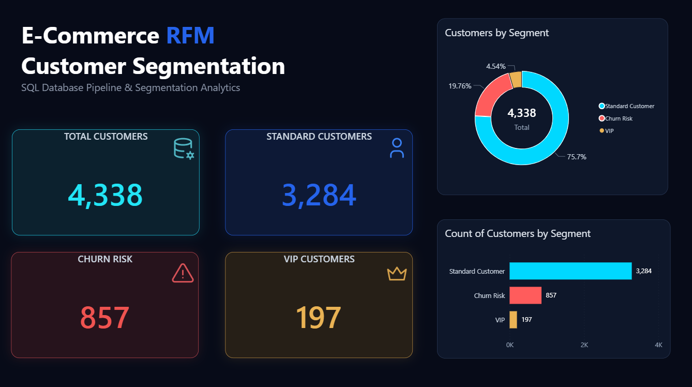

# E-Commerce RFM Customer Segmentation

## Project Overview
This project focuses on transforming over 500,000 raw e-commerce transaction records into a structured customer segmentation model. Using PostgreSQL, I built an end-to-end pipeline to perform an RFM (Recency, Frequency, Monetary) analysis. The goal was to categorize an unstructured dataset into distinct marketing tiers, allowing a business to easily identify its highest-value shoppers and those at risk of churning.

## Technologies & Skills Used
* **Database:** PostgreSQL
* **Visualization:** Power BI Desktop
* **Environment:** VS Code, pgAdmin
* **SQL Concepts:** Data type casting, subqueries, aggregate functions (SUM, COUNT, MAX), conditional logic (CASE WHEN), and data cleaning.

## Methodology & Data Pipeline

1. **Data Cleaning & Type Casting** 
   The initial Kaggle dataset contained legacy text-based dates and unstructured transaction logs. I converted these dates into native PostgreSQL `TIMESTAMP` formats to allow for date math. I also filtered out `NULL` customer IDs and negative quantities (canceled or returned orders) to prevent skewed revenue metrics.

2. **RFM Metric Calculation** 
   I used aggregate functions to create a summary profile for each customer based on three metrics:
   * **Recency:** Days elapsed since the customer's last recorded purchase.
   * **Frequency:** Total count of distinct invoices per user.
   * **Monetary:** Total lifetime revenue generated by the user.

3. **Customer Segmentation** 
   Using a `CASE WHEN` waterfall logic structure, I categorized 4,338 unique users into specific business tiers:
   * **VIP:** Customers who spent over £5,000 and placed more than 10 distinct orders.
   * **Churn Risk:** Customers who have not made a purchase in the last 180 days.
   * **Standard Customer:** All other active shoppers who do not fit the extreme tiers.

## Results
The database pipeline successfully processed the dataset and output a final, clean `customer_segments` table identifying 4,338 total customers:
* 3,284 Standard Customers (75.7%) forming the active shopper base.
* 857 Churn Risks (19.76%) requiring immediate re-engagement marketing.
* 197 VIPs (4.54%) representing the core revenue drivers.

## Dashboard
The cleaned `customer_segments` table from PostgreSQL was connected to Power BI Desktop to build a summary view of the segment distribution (`rfm_dashboard.pbix`).

